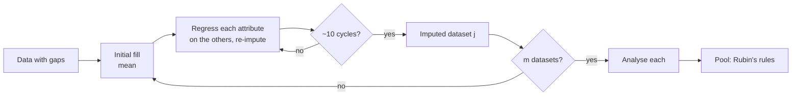

# CS950 Data Cleaning & Preprocessing
---
> [!info]- File Details
> Includes information about this (genus:: Note) from [Year::3]. Contains details on when this was created, what module the note belongs to.
> > *Date :*  15-10-2026
> > *Module :* [[]]
> > *Teacher*: 
> > *Resources :*

---
> [!abstract]+ Contents
> List of headings within this topic
> > [[#Speed run]]
> [[#]]

--- 
> [!tip]+ 🕰️* Speed run*
> Break down of topic 
> - p1
> - p2

---
---

# Data Preprocessing & Cleaning

## ⚡ Speed Run

- **Core idea**: low-quality data gives low-quality analysis, so clean the data first, then analyse.
- **Data quality problems**: missing, erroneous, suspicious, redundant, and differently-scaled attributes.
- **Missingness mechanisms**, where $R_i$ indicates which values are observed:
    - **MCAR**: $\Pr(R_i \mid Y_i) = \Pr(R_i)$. Missingness is unrelated to the data.
    - **MAR**: $\Pr(R_i \mid Y_i) = \Pr(R_i \mid Y_{i,O})$. It depends only on observed values.
    - **MNAR**: $\Pr(R_i \mid Y_i) \neq \Pr(R_i \mid Y_{i,O})$. It depends on the missing value itself.
- **Best solution**: avoid missing data altogether by planning collection and following up.
- **Listwise deletion**: drop incomplete rows. Only acceptable with lots of data and MCAR.
- **Pairwise deletion**: drop a value only from the calculations that need it. Sample size varies per attribute, and the correlation matrix may not be positive definite.
- **Single imputation** (constant, mean, class mean, regression, LOCF): biases the data and understates variability.
- **MICE**:
    1. Initialise missing values with the mean.
    2. Regress each attribute on the others and re-impute it.
    3. Repeat for ~10 cycles.
    4. Repeat the whole process to get $m$ = 5–40 datasets.
    5. Analyse each dataset and pool with Rubin's rules, $\bar{\beta} = \frac{1}{m}\sum_j \beta^{(j)}$.
- **Legitimate missingness** (e.g. "not applicable"): don't impute; offer Don't know / N/A options instead.
- **Noise smoothing**:
    - binning (by bin means or bin boundaries)
    - regression
    - clustering (outliers fall outside clusters)
    - concept hierarchies
- **Data integration**: merging sources, which raises the entity identification problem.
- **Data transformation**:
    - smoothing
    - attribute construction (risks redundancy)
    - aggregation
    - normalisation
    - discretisation
    - concept hierarchy generation
- **Min-max**: $\frac{v - \min_A}{\max_A - \min_A}(\text{new_max} - \text{new_min}) + \text{new_min}$. Bounded output, but sensitive to outliers.
- **Z-score**: $\frac{v - \bar{A}}{\sigma_A}$. Gives mean 0 and SD 1; unbounded; more robust to outliers than min-max.
- **Z-score (MAD)**: $\frac{v - \bar{A}}{s_A}$, with $s_A = \frac{1}{n}\sum|v_i - \bar{A}|$. More robust to outliers than using σ.

---

## 1. Motivation

- Datasets are highly susceptible to noisy, missing and inconsistent data.
- Analysis is expensive (hardware, cloud, salaries, time, energy), so we want the best results in the least time.
- Dirty data means we cannot trust the analysis.
- The approach is to **fix the data, then run the analysis**, which gives more reliable results.
- **Data cleaning** means filling missing values, smoothing noisy data, and identifying or removing outliers.

|Problem|Description|
|---|---|
|Missing|Value absent|
|Erroneous|Invalid value for the attribute|
|Suspicious|Plausible-looking but likely wrong, e.g. default/placeholder values|
|Redundant|Attribute contained in, or derivable from, another|
|Scale mismatch|Large-magnitude attributes dominate distance measures, so normalise|

---

## 2. Missing Data

### 2.1 Why it is a problem

- Statistics computed on observed data only may be far from the true values, causing **skew and bias**.
- If missingness is systematic (e.g. low values go unreported), every summary statistic shifts.

### 2.2 Missingness mechanisms

Each record has some _probability_ of being missing.

**Notation**

- $Y_i = (Y_{i,1}, \dots, Y_{i,p})^T$ is the vector of $p$ attributes for object $i$, where $i = 1, \dots, n$.
- $Y_{i,O}$ and $Y_{i,M}$ are the observed and missing subsets of $Y_i$.
- $R_{i,j} = 1$ if $Y_{i,j}$ is observed, otherwise $0$, and $R_i = (R_{i,1}, \dots, R_{i,p})^T$.
- The **missingness mechanism** is $\Pr(R_i \mid Y_i)$.

|Mechanism|Condition|Meaning|Illustration|
|---|---|---|---|
|**MCAR** (Missing Completely at Random)|$\Pr(R_i \mid Y_i) = \Pr(R_i)$|Unrelated to the data; observed data is representative|Hard-drive corruption|
|**MAR** (Missing at Random)|$\Pr(R_i \mid Y_i) = \Pr(R_i \mid Y_{i,O})$|Depends only on **observed** values|Younger workers (age recorded) less likely to report salary|
|**MNAR** (Missing Not at Random)|$\Pr(R_i \mid Y_i) \neq \Pr(R_i \mid Y_{i,O})$|Depends on the **unobserved** value itself|Low earners not reporting salary|

> [!tip] Classification heuristic Ask what the probability of being missing depends on:
> 
> - **Nothing** → MCAR
> - **Recorded values** → MAR
> - **The missing value itself** → MNAR
> 
> MAR vs MNAR cannot be tested from observed data alone; it is an assumption.

### 2.3 Handling strategies

1. **Delete the object**: not ideal, and infeasible if much data is missing.
2. **Fill in manually**: time-consuming and often infeasible.
3. **Global constant** (e.g. 0 or ∞).
4. **Attribute mean**.
5. **Attribute mean within the same class**.
6. **Predict the value** using regression, classification or clustering.

- Methods 3–6 **bias** the data.
- Method 6 is arguably the best, because it uses the most information from the observed data.

> [!important] The best solution is not to have missing data
> 
> 1. **Plan** the study and collect the data carefully.
> 2. Otherwise, **follow up**, e.g. recontact the individuals concerned. This is time-consuming.

### 2.4 Deletion

**Listwise (case) deletion**: delete every object with at least one missing value.

- ✅ No missing data remains.
- ✅ It is the default in many statistical libraries.
- ❌ It significantly reduces the sample size.
- ❌ It is biased if missingness is not random.
- Use it only if all three hold: **lots of data**, **MCAR**, and **true values can't be recovered**.

**Pairwise deletion**: exclude an object only from the calculations that need its missing attribute.

- ✅ All available information is used.
- ❌ Each attribute has a different sample size.
- ❌ The correlation matrix may not be **positive definite**, making it incompatible with other analyses.

### 2.5 Single imputation

|Method|How|✅|❌|
|---|---|---|---|
|**Mean substitution**|Replace with the attribute mean|Simple; uses existing data|Very inaccurate under MAR/MNAR; shrinks variance|
|**Mean by class**|Replace with the attribute mean within the object's class|Better when class means differ significantly|Very inaccurate under MAR/MNAR; undefined for a class with no observed values|
|**Regression imputation**|Predict from the other available attributes|Doesn't delete data; better guess than the mean|Adds no novel information; relies on other attributes being present and accurate|
|**LOCF** (Last Observation Carried Forward)|Time series: carry the most recent observed value forward|Easy to understand|Assumes values change little between observations; underestimates variability|

### 2.6 Multiple Imputation by Chained Equations (MICE)

**Idea**: replace missing values with a _set_ of plausible values, producing $m$ imputed datasets. Analyse each one, then combine the results into a single output.

**Algorithm**

1. **Initialise**: fill every missing value with a simple guess, e.g. the mean.
2. **Impute one attribute**: regress it on all the other attributes. Fit only on rows where it was _originally observed_, not on the initial guesses: $$\text{Att}_1 = \beta_0 + \beta_1\text{Att}_2 + \beta_2\text{Att}_3 + \dots + \beta_{p-1}\text{Att}_p$$ Then predict its originally missing values.
3. **Chain**: repeat step 2 for every other attribute, each time using the latest imputations.
4. **Cycle**: repeat the full pass over all attributes about **10 times**. The result is one imputed dataset.
5. **Multiply**: repeat steps 1–4 to obtain $m$ datasets (typically **5–40**).
    - Observed values are identical across the datasets.
    - Imputed values differ because of a **random component** in the imputation.
6. **Analyse and pool**: run the analysis on each dataset, then combine the estimates with **Rubin's rules**: $$\bar{\beta}_i = \frac{1}{m}\sum_{j=1}^{m} \beta_i^{(j)}$$

> [!note] Beyond the slides **Variance pooling.** Rubin's rules also pool the variance: $$T = \bar{W} + \left(1 + \tfrac{1}{m}\right)B$$ where $\bar{W}$ is the mean within-imputation variance and $B$ is the between-imputation variance.
> 
> **Benefits**
> 
> - ✅ Reflects uncertainty about the imputed values, whereas single imputation gives overconfident standard errors.
> - ✅ Uses all the attributes.
> 
> **Drawbacks**
> 
> - ❌ Computationally expensive.
> - ❌ Typically assumes MAR.
> - ❌ Imputed values can fall outside plausible ranges.

### 2.7 Legitimate missingness

- Some missing values are not errors. For example, a driving licence number field is legitimately empty for someone without a licence.
- Don't impute these.
- Include **Don't know** / **Not applicable** options when collecting data.

---

## 3. Noisy Data

**Noise** is random error or variance in a measured variable. The aim is to smooth it out.

### 3.1 Binning

- Binning smooths each value by consulting its **neighbourhood**: sorted values are distributed into bins.
- **Equal-frequency bins** each contain the same number of values.
- **Smoothing by bin means** replaces each value with the mean of its bin.
- **Smoothing by bin boundaries** replaces each value with whichever of its bin's min or max is closer.
- Binning also reduces the number of distinct values, so it doubles as data reduction.

### 3.2 Regression

- Smooth the data by fitting it to a function.
- **Linear regression** finds the best-fit line between two attributes, so that one can predict the other.
- **Multiple linear regression** involves more than two attributes and fits the data to a multidimensional surface.

### 3.3 Clustering

- Clustering organises similar values into groups (clusters).
- Values that fall outside every cluster may be **outliers**.

### 3.4 Smoothing by data reduction

- Many smoothing methods are also **discretisation**, and therefore **data reduction**.
- A **concept hierarchy** maps low-level concepts to higher-level ones, e.g. price → `inexpensive` / `moderately_priced` / `expensive`.
- Advantages over binning:
    - ✅ **Multiple levels of granularity** (street → town → county → country → continent).
    - ✅ **Not limited to numeric** attributes.

---

## 4. Data Integration

- **Data integration** is the merging of data from multiple sources, such as databases and data cubes.
- The **entity identification problem**: how do we match equivalent real-world entities across sources?
    - Sources may use different keys for the same entity.
    - Data at different granularities (e.g. event logs vs per-entity records) must be **aggregated** before joining.

---

## 5. Data Transformation

Data transformation converts or consolidates data into forms suitable for analytics:

1. **Smoothing**: remove noise.
2. **Attribute construction**: add new attributes derived from existing ones.
3. **Aggregation**: summarise, e.g. daily → monthly/annual.
4. **Normalisation**: scale values into a range such as $[-1, 1]$ or $[0, 1]$.
5. **Discretisation**: replace numeric values with interval labels (`0–10`, `11–20`) or conceptual labels (`youth`, `adult`, `senior`).
6. **Concept hierarchy generation for nominal data**: replace raw values with higher-level concepts, e.g. street → city/country.

### Attribute construction

- Derive a new attribute from existing ones, e.g. `area` from `length × width`.
- ✅ Improves understanding of high-dimensional data.
- ❌ Introduces **redundancy**.

---

## 6. Normalisation

Normalisation scales an attribute's values into a specified range. It matters most for **distance-based** methods such as nearest-neighbour classification and clustering. Without it, large-magnitude attributes dominate the distance and the others contribute almost nothing.

### 6.1 Min-max normalisation

A linear transformation of attribute $A$ from $[\min_A, \max_A]$ to $[\text{new_min}_A, \text{new_max}_A]$: $$v_i' = \frac{v_i - \min_A}{\max_A - \min_A},(\text{new_max}_A - \text{new_min}_A) + \text{new_min}_A$$

- ✅ Bounded, known output range.
- ❌ Outliers compress all other values towards one end of the range.
- ❌ Test values outside the training min/max fall outside the target range.

### 6.2 Z-score normalisation

$$v_i' = \frac{v_i - \bar{A}}{\sigma_A}, \qquad \bar{A} = \frac{1}{n}\sum_{i=1}^{n} v_i, \qquad \sigma_A = \sqrt{\frac{1}{n}\sum_{i=1}^{n}(v_i - \bar{A})^2} = \sqrt{\frac{1}{n}\sum_{i=1}^{n} v_i^2 - \bar{A}^2}$$

The result has **mean 0 and standard deviation 1**.

- ✅ No need to know the min/max.
- ✅ Copes with outliers better than min-max.
- ✅ Interpretable units (standard deviations from the mean).
- ✅ Equalises attribute contributions to distances.
- ✅ Unseen test values aren't forced out of a fixed range.
- ❌ Not bounded to a fixed range.
- ❌ $\bar{A}$ and $\sigma_A$ are still influenced by extreme outliers.

### 6.3 Z-score with mean absolute deviation

Replace $\sigma_A$ with the **mean absolute deviation** $s_A$: $$s_A = \frac{1}{n}\sum_{i=1}^{n} |v_i - \bar{A}|, \qquad v_i' = \frac{v_i - \bar{A}}{s_A}$$

- ✅ Deviations are not squared, so $s_A$ is less inflated by outliers than $\sigma_A$.
- ✅ As a result, non-outlier values are less compressed towards 0.

### 6.4 Comparison

||Min-max|Z-score ($\sigma$)|Z-score (MAD)|
|---|---|---|---|
|Output range|Fixed|Unbounded; μ=0, σ=1|Unbounded; μ=0|
|Requires|min, max|mean, σ|mean, $s_A$|
|Outlier sensitivity|High|Medium|Lower|
|Out-of-range values|Leave target range|Handled|Handled|
